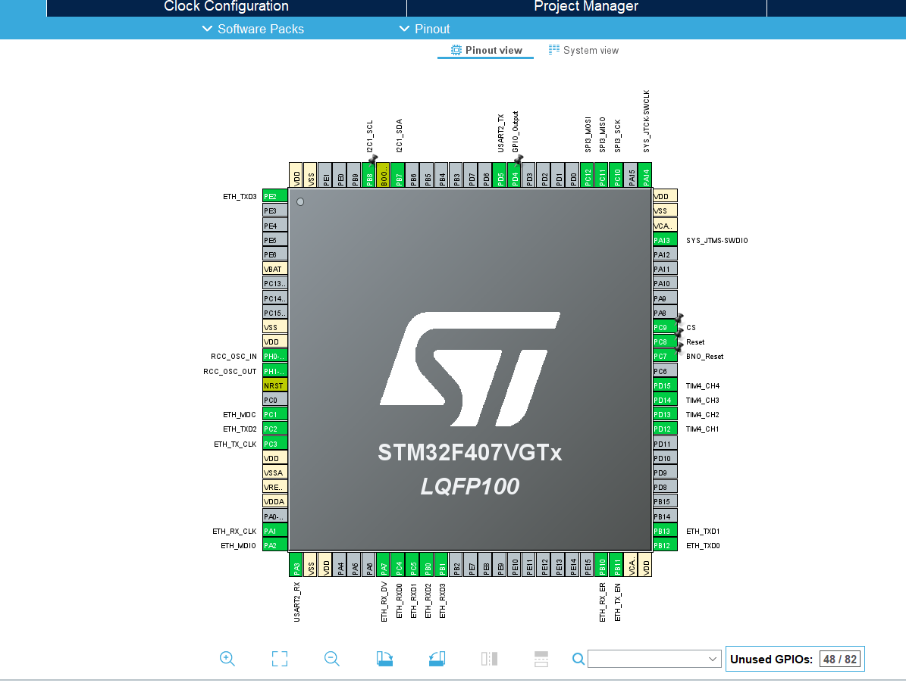

# stm32-bno055-ethernet-enc28j60-lwip
STM32F407, BNO055 verilerinden kartın yönelimini hesaplar ve ENC28J60 ile lwIP üzerinden bilgisayara gönderir. Python uygulaması kartın hareketini tarayıcıda 3B bir uçak modeliyle gösterir.
# STM32, BNO055 ve ENC28J60 ile Ethernet Üzerinden 3B Yönelim Takibi

Bu projede BNO055 sensöründen aldığımız ölçümleri STM32F407VG üzerinde işleyip Ethernet üzerinden bilgisayara aktarıyoruz. Sensörü elinizde eğdiğinizde veya döndürdüğünüzde tarayıcıdaki 3B uçak modeli de hareketi takip ediyor. Kartın kendi web arayüzünden manyetometre kalibrasyonu da başlatılabiliyor.

## Sistem nasıl çalışıyor?

1. **BNO055 → STM32:** BNO055, **AMG modunda** çalışır. STM32 yaklaşık 20 ms aralıklarla I²C üzerinden üç eksenli ivme, açısal hız ve manyetik alan ölçümlerini okur. Jiroskop kaymasını ve manyetometre hatalarını düzelttikten sonra Madgwick filtresiyle kartın üç boyutlu yönelimini hesaplar. Sonuç, `w, x, y, z` sırasıyla dört sayıdan oluşan bir *quaternion* değeridir.
2. **STM32 → Ethernet:** ENC28J60, SPI üzerinden kontrol edilen bir Ethernet denetleyicisidir. STM32 ile modül arasındaki veri SPI3 üzerinden, modül ile yerel ağ arasındaki veri ise RJ45 bağlantısı üzerinden taşınır. STM32 üzerinde çalışan **lwIP**, IP adresini, TCP bağlantılarını ve kartın HTTP sunucusunu yönetir.
3. **Ethernet → 3B model:** Bilgisayardaki Python uygulaması karta TCP ile bağlanır ve yönelim verisini alır. Tarayıcıda çalışan Three.js, bu veriye göre uçak modelini döndürür.

## Donanım bağlantıları



| Modül | Modül pini | STM32F407VG pini | CubeMX ayarı |
|---|---|---|---|
| BNO055 | SCL | PB8 | `I2C1_SCL` |
| BNO055 | SDA | PB7 | `I2C1_SDA` |
| BNO055 | RST | PC7 | `GPIO_Output` · `BNO_Reset` |
| ENC28J60 | SCK | PC10 | `SPI3_SCK` |
| ENC28J60 | SO / MISO | PC11 | `SPI3_MISO` |
| ENC28J60 | SI / MOSI | PC12 | `SPI3_MOSI` |
| ENC28J60 | CS | PC9 | `GPIO_Output` · `CS` |
| ENC28J60 | RESET | PC8 | `GPIO_Output` · `Reset` |

Modülleri kendi kartlarının besleme gereksinimine göre besleyin ve GND hatlarını STM32 ile ortaklayın. Ethernet kablosunu **ENC28J60 modülünün RJ45 girişine** takın. Görseldeki `ETH_*` etiketleri STM32’nin dahili Ethernet birimine aittir. Harici ENC28J60 bağlantısı için tablodaki SPI3, CS ve RESET pinlerini kullanın.

## Kendi STM32 projenize entegrasyon

### 1. BNO055 ve Madgwick filtresi

CubeMX'te **I2C1** birimini etkinleştirin. Örnek projede I²C hızı **50 kHz**, BNO055’in 7 bit adresi **`0x28`** olarak ayarlanmıştır. Modülünüz `0x29` kullanıyorsa `BNO055.h` içindeki `BNO055_I2C_address` değerini `(0x29 << 1)` olarak değiştirin.

`BNO055.c` ve `MadgwickAHRS.c` dosyalarını `Core/Src` klasörüne, karşılık gelen `.h` dosyalarını `Core/Inc` klasörüne ekleyin. `main.c` içindeki örnekte olduğu gibi `sensor_info.i2c = &hi2c1` ile sürücüyü I²C hattına bağlayın ve `BNO055_Init()` fonksiyonunu çağırın. Ölçüm döngüsünde `Read_BNO055()` başarılı olduğunda filtreleri güncelleyin. `MadgwickAHRSupdate()` çağrısına jiroskop verisini **radyan/saniye**, iki ölçüm arasında geçen gerçek süreyi ise **saniye** cinsinden verin.

### 2. ENC28J60 ve lwIP

CubeMX'te **SPI3** birimini master olarak etkinleştirin. `ENC28J60.c` ve `ENC28J60.h` dosyalarını projeye ekleyin. `main.c` içinde `enc.hspi = &hspi3` ile SPI hattını seçin. GPIO ve SPI başlatıldıktan sonra `ENC_init(&enc)` ile Ethernet modülünü, ardından `MX_LWIP_Init()` ile ağ yazılımını başlatın.

Bu projede lwIP ile ENC28J60 arasındaki bağlantıyı **`LWIP/Target/ethernetif.c`** kurar. `low_level_input()` modülden aldığı Ethernet çerçevesini lwIP’ye verir. `low_level_output()` ise lwIP’nin hazırladığı çerçeveyi modüle aktarır. Başka bir projeye taşırken bu dosyayı ve `LWIP/App/lwip.c` içindeki `netif_add()` çağrısında ENC28J60’a verilen `&enc` bağlantısını birlikte taşıyın.

TCP veri akışı için `TCP_Talha.c/.h`, web üzerinden kalibrasyon için `http_ssi.c/.h` kullanılır. Örnek `main.c`, ağı kurduktan sonra `tcp_server_init()` ve `http_server_init()` fonksiyonlarını çağırır. **`MX_LWIP_Process()` ana döngünün her turunda çalışmalıdır.** Böylece sensörün bir sonraki ölçüm zamanı beklenirken ağ paketleri işlenmeye devam eder.

Web arayüzünü de taşıyorsanız `lwipopts.h` içindeki `LWIP_HTTPD`, `LWIP_HTTPD_CGI` ve `LWIP_HTTPD_SSI` ayarlarını etkin tutun. Projedeki `Middlewares/Third_Party/LwIP/src/apps/http/fsdata.c` dosyası karta gömülen web sayfalarını içerir.

## IP adresini ayarlama

Kart **sabit IP** kullanır. Varsayılan ayarlarla çalıştırmak için bilgisayar ile ENC28J60’ı aynı yerel ağa bağlayın. Doğrudan Ethernet kablosuyla bağlıyorsanız bilgisayarın Ethernet bağdaştırıcısına aşağıdaki gibi boş bir IPv4 adresi verebilirsiniz.

| Ayar | STM32 | Bilgisayar için örnek |
|---|---|---|
| IP adresi | `192.168.1.20` | `192.168.1.10` |
| Alt ağ maskesi | `255.255.255.0` | `255.255.255.0` |
| Ağ geçidi | `0.0.0.0` | Doğrudan bağlantıda boş bırakılabilir |

**Kartın IP adresini değiştirirken üç yeri birlikte güncelleyin:**

| Dosya | Değiştirilecek alan |
|---|---|
| `LWIP/App/lwip.c` | `MX_LWIP_Init()` içindeki `IP_ADDRESS`. Ağınıza göre `NETMASK_ADDRESS` ve `GATEWAY_ADDRESS` değerlerini de düzenleyin. |
| `Core/Src/TCP_Talha.c` | `tcp_server_init()` içindeki `IP_ADDR4(&myIPADDR, 192, 168, 1, 20)` satırına kartın yeni IP adresini yazın. |
| `python baslat.py` | `TCP_HOST` değerini kartın yeni IP adresine ayarlayın. TCP portunu da değiştirirseniz `TCP_PORT` ile karttaki `tcp_bind()` portunu eşleştirin. |

## Çalıştırma ve 3B simülasyon

1. STM32CubeIDE'de `Ethernet2.ioc` dosyasının bulunduğu projeyi açın, derleyin ve karta yükleyin.
2. Manyetometreyi kalibre etmek için tarayıcıdan `http://192.168.1.20/calibration.shtml` adresini açın. Kalibrasyonu başlatıp sensörü farklı eksenlerde yavaşça döndürün. Kart 1500 örnek toplar, manyetik ofsetleri günceller ve yönelim verisini göndermeye devam eder.
3. Bilgisayarda Python 3 ile betiğin bulunduğu klasörden şu komutu çalıştırın:

   ```bash
   python "python baslat.py"
   ```

4. Python, **`192.168.1.20:5000`** üzerinden karttan veriyi alır. Uçak modeli ise bilgisayarda açılan **`http://127.0.0.1:5000`** sayfasında görüntülenir. Ekranda **Bağlı · quaternion akışı** yazdığında sensörü hareket ettirin.
5. Sensörü istediğiniz başlangıç konumunda tutup **Mevcut Duruşu Sıfırla** düğmesine basın. Model bundan sonraki dönüşleri seçtiğiniz konuma göre gösterir.

Python betiği standart kütüphane ile çalışır. Tarayıcı, 3B modeli çizmek için Three.js’i internet üzerinden yükler.
