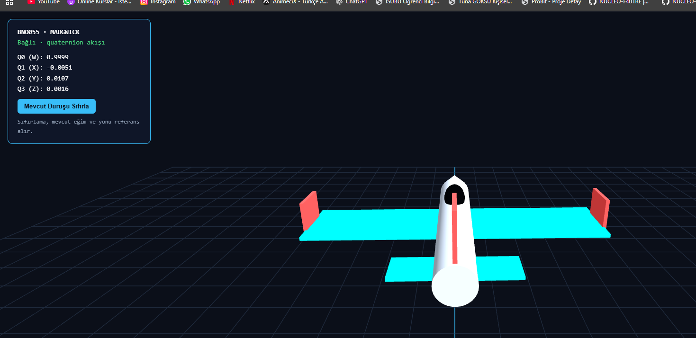
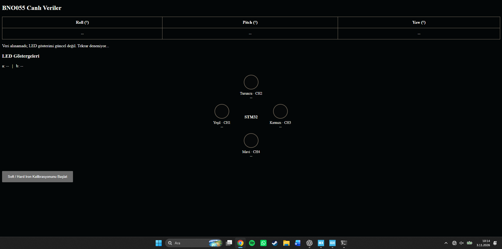

# STM32 ile Ethernet Üzerinden Yönelim Takibi ve 3B Uçak Görselleştirmesi

Bu projede BNO055 sensörünü, STM32F407VG’yi ve ENC28J60 Ethernet modülünü kullanarak kartın yönelimini bilgisayara aktardık. Sensörü eğdiğinizde veya döndürdüğünüzde tarayıcıdaki uçak modeli de bu hareketi takip eder. Aynı donanım üzerinde çalışan bir web sunucusu sayesinde kartın IP adresine girerek sensör açılarını izleyebilir ve manyetometre kalibrasyonunu başlatabilirsiniz.



## Ölçüm sensörden bilgisayara nasıl ulaşıyor?

1. **BNO055**, AMG modunda çalışır. STM32, ivmeölçer, manyetometre ve jiroskobun üçer eksenini I²C üzerinden yaklaşık 20 ms aralıklarla okur.
2. **STM32F407VG**, jiroskop ofsetini düzeltir, ivme ve manyetik alan ölçümlerini filtreler. Madgwick algoritması bu verilerden kartın üç boyutlu yönelimini hesaplar. Sonuç `w, x, y, z` sırasıyla dört sayıdan oluşan bir *quaternion* değeridir.
3. **ENC28J60 ve lwIP**, bu dört sayıyı Ethernet üzerinden taşır. Bilgisayar kartın `5000` numaralı TCP portuna bağlandığında her ölçüm bir satır hâlinde gönderilir.
4. **Python uygulaması**, TCP akışını okur ve bilgisayarda yerel bir web sayfası açar. Tarayıcıdaki Three.js uygulaması, aldığı quaternion değerini uçak modeline uygular. **Mevcut Duruşu Sıfırla** düğmesiyle kartın o anki konumunu başlangıç yönü olarak seçebilirsiniz.

## Donanım bağlantıları


| Modül | Modül pini | STM32F407VG | Görev |
|---|---|---|---|
| BNO055 | SCL | PB8 | I2C1 saat hattı |
| BNO055 | SDA | PB7 | I2C1 veri hattı |
| BNO055 | RST | PC7 | Sensör reset çıkışı (`BNO_Reset`) |
| ENC28J60 | SCK | PC10 | SPI3 saat hattı |
| ENC28J60 | SO / MISO | PC11 | Modülden STM32’ye veri |
| ENC28J60 | SI / MOSI | PC12 | STM32’den modüle veri |
| ENC28J60 | CS | PC9 | SPI cihaz seçimi |
| ENC28J60 | RESET | PC8 | Ethernet modülü reset çıkışı |

Modülleri kendi besleme gereksinimlerine göre besleyin ve GND hatlarını ortaklayın. Ethernet kablosunu **ENC28J60’ın RJ45 girişine** takın. Görseldeki `ETH_*` etiketleri STM32’nin dahili Ethernet çevre birimine aittir. Bu projede Ethernet paketleri **SPI3 üzerinden ENC28J60’a** aktarılır.

## ENC28J60 sürücüsü ve lwIP ne işe yarıyor?

**ENC28J60**, SPI ile kontrol edilen bir Ethernet denetleyicisidir. Ağ kablosundan gelen Ethernet çerçevelerini kendi belleğinde tutar. STM32, sürücü aracılığıyla bu çerçeveleri okur veya göndereceği çerçeveyi modülün iletim belleğine yazar.

**lwIP**, STM32 üzerinde çalışan hafif bir TCP/IP yazılımıdır. Kartın IP adresini, TCP bağlantılarını ve HTTP isteklerini yönetir. İkisini birbirine bağlayan dosya `ethernetif.c`’dir. Örneğin tarayıcı karttan bir sayfa istediğinde ENC28J60 çerçeveyi alır, `ethernetif.c` bunu lwIP’ye verir ve HTTP sunucusunun yanıtı aynı yoldan kabloya çıkar.

| Depodaki dosya | Projedeki görevi |
|---|---|
| `Src/ENC28J60.c` ve `Inc/ENC28J60.h` | Modülü resetler, MAC ve alım/gönderim tamponlarını ayarlar. `receive_message()` gelen çerçeveyi okur, `transmit_frame()` giden çerçeveyi modüle yazar. |
| `LWIP/Target/ethernetif.c` | `low_level_input()` ile gelen çerçeveyi lwIP’nin `pbuf` tamponuna aktarır. `low_level_output()` ile lwIP’den gelen veriyi ENC28J60 sürücüsüne verir. |
| `LWIP/App/lwip.c` | IP adresini ve ağ maskesini ayarlar, `netif_add()` ile ENC28J60’ı ağ arayüzü olarak kaydeder. `MX_LWIP_Process()` gelen paketleri ve ağ zamanlayıcılarını işler. |
| `LWIP/Target/lwipopts.h` | lwIP’nin derleme ayarlarını içerir. Projede HTTP sunucusu, SSI ve CGI desteği buradan etkinleştirilir. |
| `Src/TCP_Talha.c` | `5000` numaralı portu dinler. Bağlanan istemciye quaternion değerlerini virgülle ayrılmış satırlar hâlinde gönderir. |
| `Src/http_ssi.c` | Sensör ve kalibrasyon değerlerini web sayfasına aktarır. Tarayıcıdan gelen kalibrasyon isteğini işler. |

## Kendi STM32CubeIDE projenize entegrasyon

Depodaki `Src` ve `Inc` klasörleri uygulamanın kaynaklarını içerir. Entegrasyona STM32F407VG için oluşturduğunuz bir CubeIDE projesiyle başlayın.

1. **Çevre birimlerini ayarlayın.** CubeMX’te **I2C1** birimini 50 kHz, **SPI3** birimini master olarak yapılandırın. Pinleri bağlantı tablosuna göre seçin. PC7, PC8 ve PC9’u GPIO çıkışı yapıp sırasıyla `BNO_Reset`, `Reset` ve `CS` olarak adlandırın.
2. **BNO055’i ekleyin.** `BNO055.c` ve `MadgwickAHRS.c` dosyalarını kendi projenizin `Core/Src`, karşılık gelen başlıkları `Core/Inc` klasörüne alın. Örnek `Src/main.c` içindeki gibi `sensor_info.i2c = &hi2c1` ile sensörü I²C hattına bağlayın. `BNO055_Init()` sensörü AMG moduna geçirir. Varsayılan 7 bit adres `0x28`’dir. Modülünüz `0x29` kullanıyorsa `Inc/BNO055.h` içindeki `BNO055_I2C_address` değerini `(0x29 << 1)` yapın.
3. **Ethernet sürücüsünü bağlayın.** `ENC28J60.c/.h` dosyalarını ekleyin. `enc.hspi = &hspi3` ile SPI hattını seçin. GPIO ve SPI hazır olduğunda önce `ENC_init(&enc)`, ardından `MX_LWIP_Init()` çağrılır. lwIP entegrasyonu için depodaki `LWIP/App` ve `LWIP/Target` klasörlerini esas alın. Aynı adlı kök dosyaları ikinci kez derlemeye eklemeyin.
4. **TCP ve web hizmetlerini ekleyin.** `TCP_Talha.c/.h` ile `http_ssi.c/.h` dosyalarını projeye alın. `lwipopts.h` içinde `LWIP_HTTPD`, `LWIP_HTTPD_SSI` ve `LWIP_HTTPD_CGI` etkin olmalıdır. Ağ başlatıldıktan sonra `tcp_server_init()` ve `http_server_init()` çağrılır.
5. **Ana döngüyü bağlayın.** `MX_LWIP_Process()` ana döngünün her turunda çalışır. Sensör okuma ve filtreleme ise yaklaşık 20 ms’de bir yapılır. Böylece bir sonraki sensör örneği beklenirken kart, tarayıcıdan veya Python istemcisinden gelen ağ paketlerini işlemeye devam eder.

## Kartın web arayüzü ve PWM göstergeleri



Kartın web panelinde **roll, pitch ve yaw** alanları ile manyetometre kalibrasyon düğmesi bulunur. Tarayıcı `/data.shtml` üzerinden ölçümleri ister. Karttaki **SSI** işleyicisi sayfadaki alanları sensör değerleriyle doldurur. Kalibrasyon düğmesi ise `/calibrate.cgi?start=1` isteğini gönderir. Kart 1500 örnek toplarken sensörü farklı yönlere çevirerek manyetik alanın her eksendeki alt ve üst değerlerini ölçebilirsiniz.

Görseldeki dört LED, **TIM4’ün dört PWM kanalına** karşılık gelir. PWM’de çıkış belirli bir periyotla açılıp kapanır. Sinyalin açık kaldığı sürenin periyoda oranı *görev oranıdır*. Bir LED çıkışında bu oran artırıldığında LED’in ortalama parlaklığı artar.

| TIM4 kanalı | Pin | Paneldeki gösterge |
|---|---|---|
| CH1 | PD12 | Yeşil |
| CH2 | PD13 | Turuncu |
| CH3 | PD14 | Kırmızı |
| CH4 | PD15 | Mavi |

Paylaşılan ekran görüntüsünde panel veri beklediği için açı ve LED alanları `--` gösteriyor. **Depodaki `Src/main.c` sürümünde fiziksel PWM çıkışını başlatan çağrılar bulunmuyor.** Kart üzerinde LED parlaklığını da sürmek için CubeMX’te TIM4 kanallarını **PWM Generation** olarak etkinleştirin, her kanalı `HAL_TIM_PWM_Start()` ile başlatın ve görev oranını ilgili kanalın karşılaştırma değeriyle ayarlayın.

## `fsdata.c` nedir ve nasıl oluşturulur?

STM32’nin HTTP sunucusu, tarayıcının istediği HTML ve SHTML sayfalarını kartın flash belleğinden sunar. Depodaki **`http/fs/`** klasörü düzenlenebilir web dosyalarını içerir. **`http/fsdata.c`** ise bu dosyaların adlarını ve içeriklerini C dizileri hâlinde firmware’e ekleyen üretilmiş dosyadır.

Örneğin ana sayfadaki bir düğmeyi değiştirmek için:

1. `http/fs/index.html` dosyasını düzenleyin. Canlı veri alanları için `http/fs/data.shtml`, kalibrasyon sayfası için `http/fs/calibration.shtml` kullanılır.
2. Windows’ta terminali **`http` klasöründe** açın. `fs` klasörü ile `makeFSdata.exe` aynı dizinde olmalıdır.
3. Depoyla gelen üretim aracını çalıştırın:

   ```powershell
   .\makeFSdata.exe
   ```

4. Oluşan `fsdata.c` dosyasını kendi lwIP HTTP sunucunuzun kullandığı konuma alın. CubeIDE projelerinde bu genellikle `Middlewares/Third_Party/LwIP/src/apps/http/` klasörüdür. HTTP sunucusundaki `fs.c`, bu içeriği `HTTPD_FSDATA_FILE` üzerinden dahil eder.
5. Firmware’i yeniden derleyip karta yükleyin. Kartın IP adresini tarayıcıda açtığınızda güncel sayfa flash bellekten sunulur.

## IP adresi ve çalıştırma

Kartın varsayılan adresi **`192.168.1.20`**, ağ maskesi **`255.255.255.0`**. Bilgisayar ile ENC28J60’ı aynı yerel ağa bağlayın. Doğrudan kablo kullanıyorsanız bilgisayarın Ethernet bağlantısına örneğin `192.168.1.10` adresini ve aynı ağ maskesini verebilirsiniz.

Kartı farklı bir IP adresine taşırken üç ayarı birlikte güncelleyin:

| Dosya | Ayar |
|---|---|
| `LWIP/App/lwip.c` | `IP_ADDRESS` ve ağınıza göre `NETMASK_ADDRESS` |
| `Src/TCP_Talha.c` | `tcp_server_init()` içinde `IP_ADDR4()` ile belirtilen dinleme adresi |
| `python baslat.py` | Python istemcisinin bağlandığı `TCP_HOST` |

**Kartın web paneli** için firmware’i yükledikten sonra tarayıcıda `http://192.168.1.20/` adresini açın.

**3B uçak ekranı** için bilgisayarda `python baslat.py` dosyasının bulunduğu klasörde şu komutu çalıştırın:

```bash
python "python baslat.py"
```

Python, kartın `192.168.1.20:5000` TCP adresine bağlanır ve bilgisayarda `http://127.0.0.1:5000` adresini açar. **Bağlı · quaternion akışı** yazısını gördüğünüzde sensörü hareket ettirerek modeli takip edebilirsiniz. Betik Python’un standart kütüphanesini kullanır. Tarayıcı, 3B çizim için Three.js’i internet üzerinden yükler.
